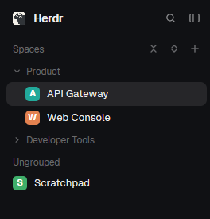

# Herdr Space Grouping

A desktop mod for Herdr App. In the expanded Spaces sidebar, right-click a space and choose **Move to group…**. Pick an existing group, enter a new group name, or choose **Ungrouped**. Click a group heading to collapse or expand it, or use the two chevron icons beside **+** to collapse or expand all groups.

Open **Space Group Settings** from the command palette to list and rename groups. Empty groups stay in Settings and **Move to group…**, but are hidden from the sidebar.

New spaces always start ungrouped. Groups are scoped to each machine and saved in the desktop app’s local settings. They don’t change your terminals, the core’s space structure, or CLI behavior. The narrow sidebar keeps its stock appearance.



## Install

Tested with Herdr App **0.1.18**. Download the `herdr-space-grouping-v*.zip` asset and its checksum from the [latest stable release](https://github.com/kaizen-inc/HerdrSpaceGrouping/releases/latest); the default branch is for development. This is an independent community layout, not part of Herdr. Herdr mods run as trusted code, so review the files before installing.

Extract the ZIP and run `bash install.sh` from the extracted folder (Git Bash on Windows). It copies three mods and a layout into `HERDR_APP_HOME`, or `~/.config/herdr-app` if unset. It refuses to replace an existing installation or same-named custom files.

If you already installed this mod, run `bash install.sh --update` instead. It replaces the mod files (including any edits you made to those files), but leaves saved groups and your existing layout untouched.

With the desktop app open, select the **grouped-spaces** layout, or run:

```sh
herdr-app do layout.switch --name grouped-spaces
```

To revert, switch to **main** (or your previous layout). The mod does not edit shipped files. Its copies of the stock sidebar, menu, and layout do not get upstream fixes automatically.

## Developers

See [Contributing](CONTRIBUTING.md) for setup and checks, [Releasing](docs/RELEASING.md) for the branch and tagging workflow, and [the recipe](RECIPE.md) for the Herdr community layout.

The sidebar, menu, and layout are adapted from [Herdr App](https://github.com/herdrdev/herdr-app) under Apache 2.0; see [LICENSE](LICENSE).
