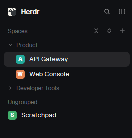

# Herdr Space Grouping

Build a Herdr App 0.1.18 layout based on the shipped main layout. Replace only its Spaces panel with a copy of the stock mod. Keep existing machine sections, status and Git details, selection, reorder behavior, and the compact sidebar. Use Herdr's JavaScript mod APIs and GPUI elements, not a core extension or web view.

## What it looks like

The expanded Spaces header keeps its plus button and adds two chevron icons for **Collapse all groups** and **Expand all groups**. Show a flat list of named group headers within each machine, then an **Ungrouped** section if both grouped and ungrouped spaces are visible. A header has a chevron and the group's name; its direct children are indented space rows, never more groups. A folded header highlights when it contains the active space. Hide empty headers and keep the narrow rail unchanged.

## How it works

- Right-click an expanded space and keep the stock actions. Add **Move to group…**, a dialog with **Ungrouped**, all saved group names for that machine, and a field to create a group and move the space into it.
- New spaces start ungrouped. Each space can belong to one group on its machine. Group membership changes only via the dialog. The grouping actions do not change the core's order, tabs, terminals, or CLI.
- Click a header to toggle it. The header icons apply to groups across machines, including saved empty groups, not to machine headers or Ungrouped spaces. Icon controls have tooltips and support Enter/Space.
- **Space Group Settings** in the command palette lists saved groups by machine. Selecting a Rename row opens an input and Save action. Trim new names, reject blanks and same-machine conflicts, and preserve membership and folded state.
- Save under app-local shared key `spaces-grouping.v1`. Use the machine identity and stable space ID, not the display name. Store group names independently of members; old state lacking the names list derives names from members. Never prune groups based on which spaces are currently visible.

## Files

`layouts/grouped-spaces.json` points to `mods/grouped-spaces/`; it opens `grouped-spaces-menu` and `space-group-picker` for grouping actions. Herdr resolves relative imports locally, so both the sidebar and picker ship a byte-identical `groups.js`. Install the three mod directories and the layout into the app home without editing shipped files. See the README for the installer and stable downloads.
